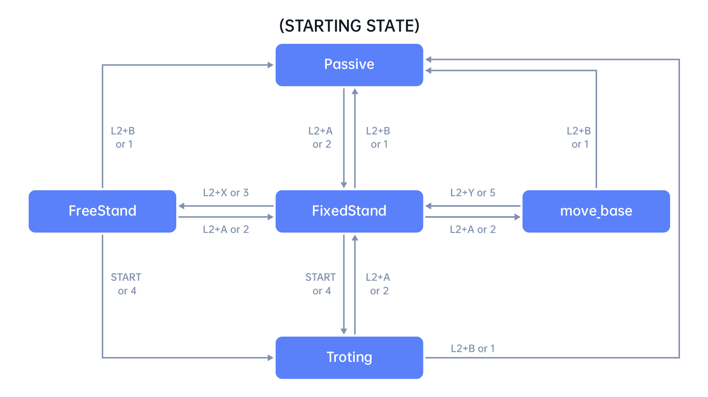

# Unitree Go2 EDU + Orin quickstart

Getting started with Go2 EDU + expansion dock:
- interfaces
- how to connect
- how to backup

The expansion dock is Jetson Orin Nano, **ARM64** architecture.


[Unitree Payload documentation](https://support.unitree.com/home/en/developer/Payload)


## System architecture

The Go2 has WiFi, 4G, BLE, on the main board, intended to interact with the app. **These are NOT accessible from the expansion dock (Jetson Orin).**


[Architecture Description](https://support.unitree.com/home/en/developer/Architecture%20Description)

[Hardware architecture](https://support.unitree.com/home/en/developer)

| Interface hardware | Protocol / data | Intended use | How to connect |
|---|---|---|---|
| Bluetooth Low Energy | BLE | Initial pairing, app setup and network configuration | Pair the Go2 in the Unitree Go App |
| Wi-Fi module | Dual-band Wi-Fi 6 (`802.11ax`), TCP/IP, WebRTC | Local control, FPV video and app/PC communication | Join a router through the app or use the Go2 access point |
| Cellular | 4G LTE/eSIM, MQTT, WebRTC, HTTP | Remote telemetry, monitoring and OTA updates | Configure cellular service in the app; availability depends on region and authorization |
| Ethernet | RJ45 or supported dock Ethernet connector; DDS/TCP/IP/GST | Reliable SDK, ROS 2, video and computer-to-robot communication | Connect the PC or Orin and use the same `192.168.123.0/24` subnet |
| Ultra-Wideband | UWB ranging and positioning | Follow-me mode and tracking-remote positioning | Power and pair the supported UWB remote/tag |
| Internal serial buses | UART, CAN and SPI | Communication between motors, sensors and internal controllers | Internal wiring; not a normal user-facing interface |

## Hardware & interfaces


[Unitree Payload documentation](https://support.unitree.com/home/en/developer/Payload)

**Ports frontside**: GH1.25-4PIN Gigabit ethernet, M8 plug, power pins, RJ45 (go2 main board), USB-C (optional depth camera)

**Ports backside**: USB-A, Power supply pins, RJ45, USB-C

## Development

### Monitor

Connecting a display screen requires a **USB-C-to-HDMI** adapter.


[Unitree Expansion dock config](https://support.unitree.com/home/en/developer/module_update)
### Connection

Expansion dock (orin) connects to  Go2 by power cable (28.8 V DC) and ethernet.

| Hardware Component | Static IP Address | Subnet Mask | Purpose / Notes |
|---|---|---|---|
| Expansion Dock PC | **`192.168.123.18`** | `255.255.255.0` | SSH and run ROS 2 code. |
| Motion Control PC | `192.168.123.161` | `255.255.255.0` | Low-level controller (restricted access). |
| Development PC | `192.168.123.222` | `255.255.255.0` | Suggested static IP|

```ssh unitree@192.168.123.18```
default password: 123

### Interfaces

| Interface | Description |
|---|---|
| DDS | **Data Distribution Service**: the Go2's publish/subscribe communication layer for sending commands and receiving robot data. Supported from C++ and Python through the **Unitree SDK**. (CycloneDDS) |
| ROS 2 | Robotics middleware interface for using Go2 data and services as ROS 2 topics, services and messages. ROS 2 normally uses DDS underneath. |
| GST | **GStreamer** interface used only for transmitting camera images/video; it is not a robot-control interface. |

#### Go2 SDK

##### Usefull docs

https://support.unitree.com/home/en/developer/SDK_Concepts - startpunt.

https://support.unitree.com/home/en/Go2-W_developer/Operation_guide

https://support.unitree.com/home/en/Algorithm_Practice/fsm (niet exact Go2)


##### Safety essentials

- Check the firmware version. Use the V2 documentation for software V1.1.6 and later. Modes and commands may differ.
- `SportClient` uses the high-level motion service. Disable this service only for intentional low-level motor control. `go2_stand_example.cpp` is a low-level example.
- `StandUp()` means Standing Lock. Do not use as a long-term rest state. The motors may overheat. `StandDown()` (laying down) is also locked.
- An RPC success means the command was accepted. It does not confirm the final pose. Wait for a new state update.
- A timed-out command may still run. Do not retry it blindly or start an immediate recovery sequence.
- Use one motion-command owner. Stop background loops before shutdown. They may keep sending `Euler()` or `Move()` commands.

##### Requirements

OS: Ubuntu 20.04 or 22.04

WSL2 works but considered **unreliable** : 
add the file %USERPROFILE%\.wslconfig
with contents 
```
[wsl2]
networkingMode=mirrored
```

##### FSM

[FSM & State Machine Transitions](https://support.unitree.com/home/en/Algorithm_Practice/fsm)

##### V2 motion modes

On V2 firmware, `SportModeState.error_code` may contain a motion mode. It is not always an RPC error or API ID.

| Value | Mode |
|---:|---|
| `100` | Agile |
| `1001` | Damping |
| `1002` | Standing Lock |
| `1013` | Balance Standing |
| `1091` | Strike a Pose |


##### Pose and stopping

The official pose example repeats this sequence:

```text
Euler(target)
BalanceStand()
short pause
```

On normal exit, send `Euler(0, 0, 0)`. This sets a neutral target. It does not restore the exact starting pose. Wait for the robot and verify its state before changing modes.

Keep these timings separate:

- RPC timeout
- command-loop interval
- physical transition timeout

There is no safe universal delay.

`StopMove()` stops the current motion and resets motion parameters. It does not guarantee a neutral pose, joint lock, or relaxed motors. Do not run automatic recovery when the state is unknown, communication is lost, or a motor fails. Hand control to the operator.

##### Controller mappings

Details in [sdk_go2](sdk_go2.md), which controller instructions map to which `SportsClient` commands. 

## Orin filesystem

Unitree does not publish a complete inventory of every factory image. A typical installation looks like this:

```text
/
├── home/
│   └── unitree/          # User code and optional ROS workspaces
├── opt/
│   ├── ros/foxy/         # ROS 2 Foxy, when installed
│   └── unitree_robotics/ # Possible SDK2 installation location
├── usr/local/
│   └── cuda/             # NVIDIA CUDA
├── etc/
│   ├── systemd/          # System services
│   └── NetworkManager/   # Network configuration, including static Ethernet
├── var/log/              # System and service logs
└── boot/                 # Kernel, device tree and Jetson boot configuration
```

### Inspect the actual installation

Connect through SSH and run the following commands to obtain the exact OS version, Jetson version, installed packages, directories and enabled services of your dock:

```bash
ssh unitree@192.168.123.18

cat /etc/os-release
uname -a
cat /etc/nv_tegra_release
dpkg-query -W | sort
find /home/unitree -maxdepth 2 -type d | sort
ls -ld /opt/ros/* /opt/unitree_robotics /usr/local/cuda* 2>/dev/null
systemctl list-unit-files --state=enabled
systemctl --failed
```

## Orin backup

See [Orin backup](ORIN_BACKUP.md) for requirements and the complete backup procedure.
